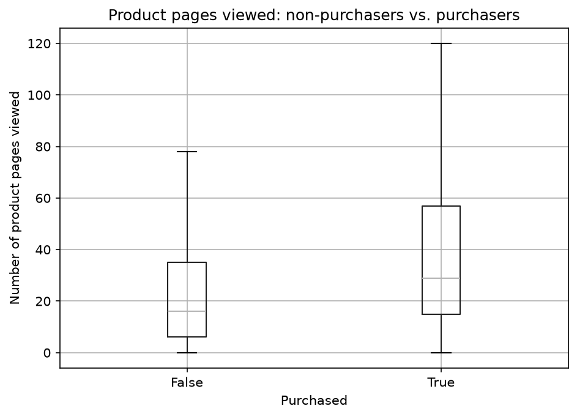
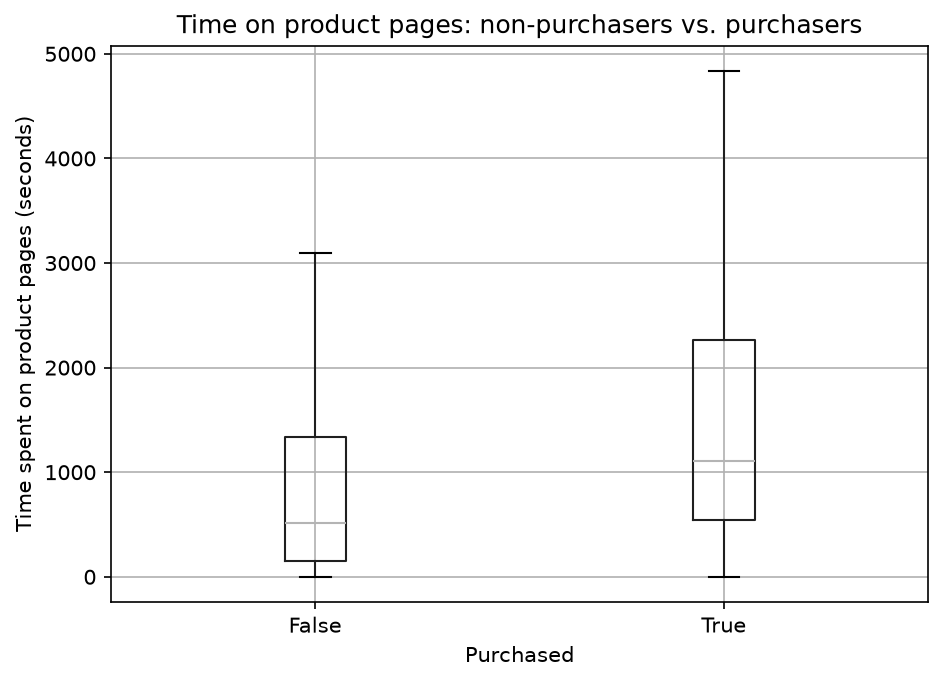
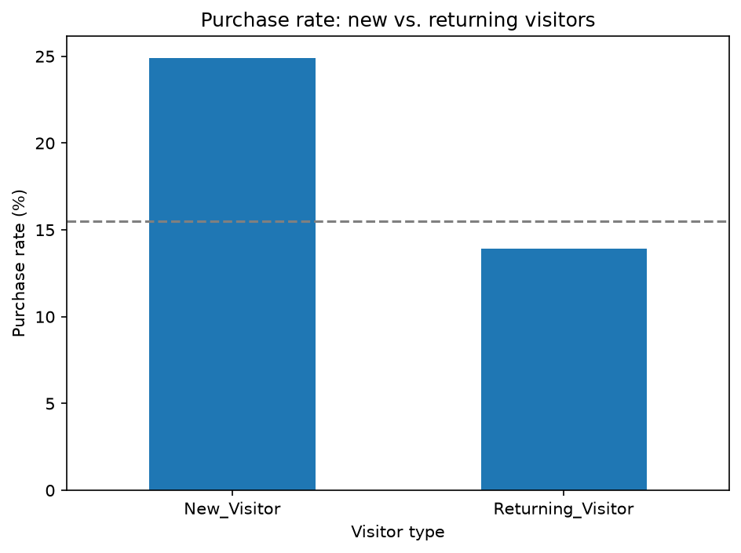
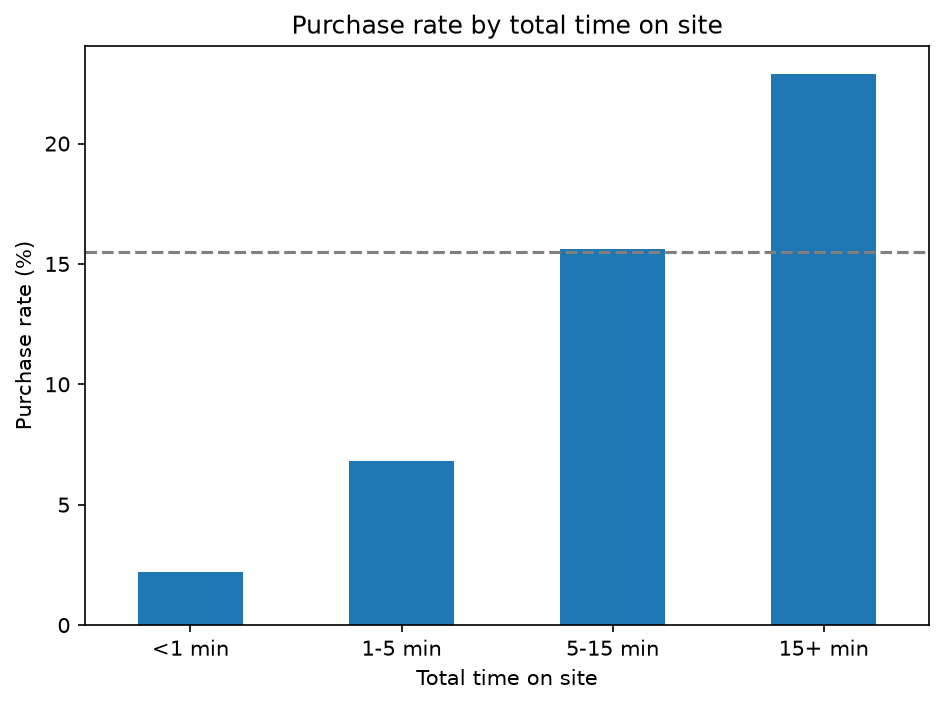

# Online Shopper Purchase Behavior Analysis

## Question
Which browsing behaviors are linked to whether a session ends in a purchase? This can help an online store improve its page content to appeal to visitors.

## Data
- Source: [UCI Online Shoppers Purchasing Intention Dataset](https://archive.ics.uci.edu/dataset/468/online+shoppers+purchasing+intention+dataset) (Sakar & Kastro, 2018)
- License: CC BY 4.0
- Size: 12,330 rows and 18 columns
- Each row is one session (one visit to the website)
- Overall purchase rate: 15.5%
## Methods
- Tools: Python (pandas, matplotlib, scipy)
- Summary numbers: median for Q1, because the data is right-skewed; purchase rate (%) for Q2 and Q3
- Charts: box plots for Q1; bar charts with a 15.5% baseline for Q2 and Q3
- Tests: Mann-Whitney U test for Q1 (comparing numbers between two groups); chi-square test for Q2 and Q3 (comparing categories)
- Significance level: p < 0.05
- Data prep: removed "Other" visitors for Q2 (only 85 rows); grouped total time into four groups for Q3 
- Did not use PageValues, because it is calculated from purchases (data leakage)

## Findings

### Q1: Do purchasers view more pages and stay longer?
Yes. Buyers viewed more product pages and stayed longer than non-buyers.

- Pages viewed (median): 29 for buyers vs. 16 for non-buyers
- Time on product pages (median): about 18.5 minutes for buyers vs. about 8.5 minutes for non-buyers
- About 75% of buyers viewed at least 15 pages, which is close to what a typical non-buyer viewed
- Mann-Whitney U test: p < 0.001 for both, so we reject the null hypothesis. The differences are statistically significant.

### Q2: Do new and returning visitors buy at different rates?
Yes. New visitors bought more often than returning visitors.

- Purchase rate: 24.9% for new visitors vs. 13.9% for returning visitors (overall average: 15.5%)
- If there were no difference, we would expect about 262 new-visitor sessions to end in a purchase. The actual number was 422.
- Returning visitors had fewer purchases than expected (1,470 actual vs. about 1,630 expected).
- Chi-square test: p < 0.001, so we reject the null hypothesis. The purchase rates are different.

### Q3: Does purchase rate change with total time on site?
Yes. The longer a session lasted, the more likely it ended in a purchase.

- Purchase rate: 2.2% (less than 1 min), 6.8% (1–5 min), 15.6% (5–15 min), 22.9% (more than 15 min)
- Sessions of 5–15 minutes were close to the overall average (15.5%). Only sessions over 15 minutes were clearly above it.
- Short sessions bought much less than expected (31 actual vs. about 218 expected). Long sessions bought much more (1,188 actual vs. about 801 expected).
- Chi-square test: p < 0.001, so we reject the null hypothesis. The purchase rates are not the same across the four groups.

## Recommendations
These ideas should be tested first with an A/B test, one change at a time, since this analysis shows links, not causes.

1. **Keep short visitors on the site.** 
   - Finding: Sessions under 1 minute had a purchase rate of only 2.2%. 
   - Idea: Check if pages load slowly, and make the landing page clearer so popular products are easy to find.
2. **Help long visitors finish buying.** 
   - Finding: Sessions over 15 minutes had a purchase rate of 22.9%.
   - Idea: Try a reminder or a small discount for these visitors. Track revenue as well as purchase rate, because many of them might buy even without a discount.
3. **Keep investing in new visitors, and learn why returning visitors buy less.** 
   - Finding: New visitors bought more often than returning visitors (24.9% vs. 13.9%).
   - Idea: Try a next-visit discount for first-time buyers, and look into why returning visitors buy less (for example, they may come back just to compare prices).

## Limitations
- This analysis shows a link, not a cause. For example, we don't know if staying longer makes people buy, or if people who already plan to buy just stay longer.
- The data comes from one online store, so the results may not apply to other stores.
- The data was published in 2018. Online shopping habits may have changed since then.
- Each session belongs to a different user, so we only see one visit per person. We can't see a shopper's earlier visits or how many times they came before buying.

## How to run
1. Download this project (on GitHub, click **Code → Download ZIP**) and unzip it.
2. Install Python 3 and the packages:
